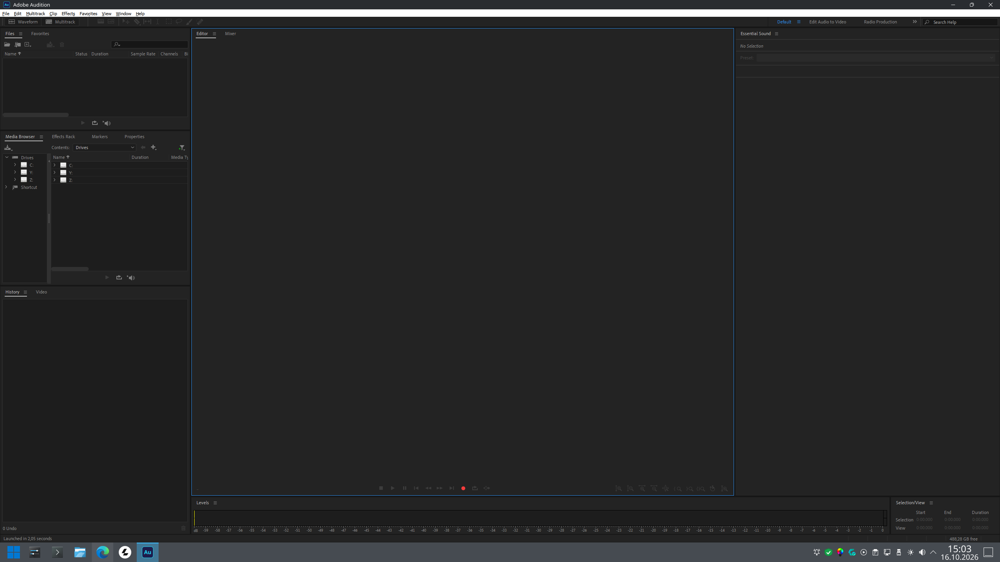
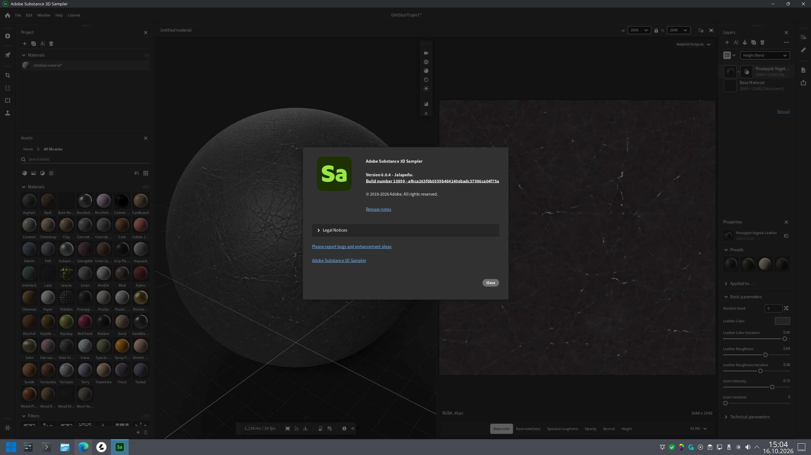
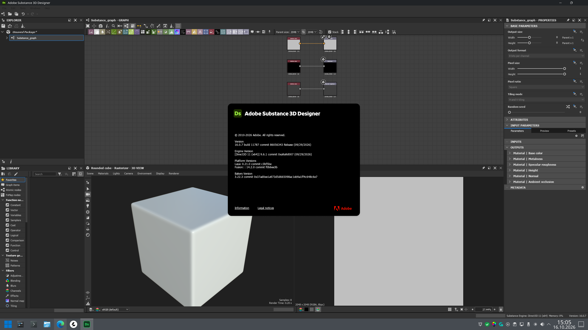
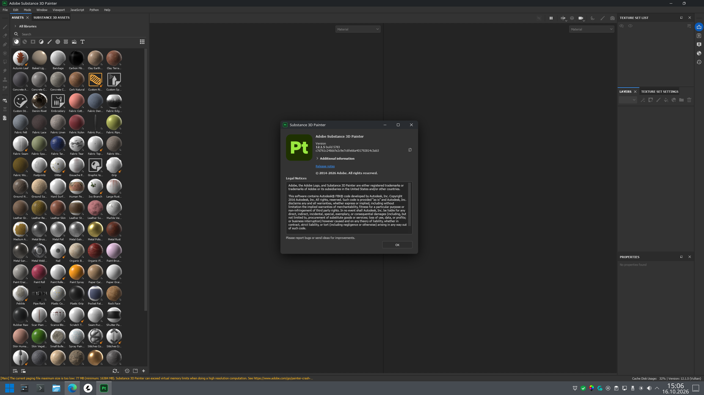

# Adobe Substance 3D + Audition Wine Panel

A PyQt6 control panel to run **Adobe Substance 3D (Painter, Designer, Sampler)** and **Adobe Audition** on Linux via a **patched Wine build** (win32u Vulkan shared-resource fix), with one-click runtimes, DLL repair and start-menu integration.

Interface languages: **Türkçe / English / Deutsch** (switchable from the header, persisted in `~/.config/adobe-wine-panel/lang`).

    

## Features

- **One-file app**: `adobe-wine-panel.py` — no install step, just run.
- **Patched Wine manager** (`/opt/wine-patched`, Wine 11.19):
  - Applies `d3dkmt_open_resource` fallback fix in `dlls/win32u/vulkan.c` for `VK_KHR_external_memory_win32`
  - Builds 32+64-bit with all CPU cores + `ccache`
  - Packages as `wine-patched` pacman package, wires `/usr/bin/wine*` symlinks, `wine.desktop` + MIME defaults
  - `pacman IgnorePkg` guard so updates can't break it
- **Adobe apps**:
  - Substance 3D Sampler, Designer, Painter + Audition 2026 launch cards
  - Generates official-style **Pt / Sa / Ds / Au** 256×256 PNG + SVG icons
  - Rebuilds KDE/GNOME start-menu `.desktop` entries, refreshes icon cache
  - Shortcuts are created **only for apps actually installed** in the prefix; duplicate / wine-generated extra entries are cleaned up
  - Launch wrapper `adobe-wine-run` stops Adobe/Wine helpers and closes the prefix (`wineserver -k`) when the app exits
- **Audio fix for Audition**: pins `HKCU\Software\Wine\Drivers\Audio` to `winepulse.drv` (PipeWire/PulseAudio)
- **Wine cleanup**: `adobe-wine-kill` helper (safe / `--helpers-only` / `--full`) + a cleanup action in the panel; leaves no Adobe/Wine helper processes behind (a common freeze source on NVIDIA + KDE)
- **KDE/NVIDIA window fixes** (action): per-display *Prefer efficiency* color mode, `AllowTearing` and a 99 % opacity window rule — workarounds for the dark/stale-window bug on KWin 6.8 + NVIDIA (files are backed up; KWin is reconfigured)
- **Wayland**: ensures `HKCU\Software\Wine\Drivers` → `Graphics=wayland` on Wayland sessions
- **Runtimes tab (one-click)**:
  - Visual C++ Redistributable 2005–2022 (x86 + x64)
  - Direct msvcp140/vcruntime140 DLL repair via `cabextract` (`vc_redist` → `system32`/`syswow64` + `wineserver -k` + `native,builtin` overrides)
  - DirectX 9/10/11/12, d3dcompiler, DXVK, VKD3D, Vulkan
  - Microsoft .NET Framework 4.8 + .NET Desktop Runtime 6.0 / 8.0 LTS
  - Windows Python 3.12 (amd64 + PIP) inside Wine
  - Eclipse Temurin Java JRE 21 LTS (Windows x64, MSI)
  - Corefonts, Tahoma, gdiplus, msxml3/6, winhttp, ucrtbase, webview2 stub
  - Winetricks GUI launcher
- **Diagnostics**: startup + on-demand scan (Wine core, icons, MIME, prefix, Vulkan, disk, runtimes, Wayland graphics driver, KDE color mode) with guided fixes
- **Multilingual UI**: header language switcher (TR/EN/DE), auto-detects system locale on first run

## Screenshots

Running on Arch Linux + patched Wine 11.19:

| Audition | Sampler |
|---|---|
|  |  |

| Designer | Painter |
|---|---|
|  |  |

## Security / VirusTotal

`adobe-wine-panel.py` is plain-text Python — you can read every line before running it. No binaries, no obfuscation.

- SHA256 (`v2.0`): `44483cdb6daf4bfebbea6a095f15f61f9ae4aba22180eaa66658d6cfd10e6200`
- VirusTotal analysis (v1.0 file): https://www.virustotal.com/gui/file/60902734b01cce6f5cc9fd5277b82574e650626f9307d9c5d7b28bff7a21f7fb
- Verify locally: `sha256sum adobe-wine-panel.py`

> Note: every commit changes the hash. Re-upload the file to VirusTotal when it changes; download the exact release asset to match a published hash.

## Requirements

- Arch Linux (or Arch-based; uses `pacman`, `makepkg`)
- Python 3.10+ with `PyQt6`
- Build deps (auto-installed): `base-devel`, `mingw-w64-gcc`, `ccache`, `winetricks`, `cabextract`, `unzip`, `p7zip`, `vulkan-headers`, etc.
- ~5 GB free space for Wine build + runtimes

## Quick start

```bash
git clone https://github.com/Utku92/adobe-substance-3d-audition-wine-panel.git
cd adobe-substance-3d-audition-wine-panel
pip install -r requirements.txt
chmod +x adobe-wine-panel.py
python3 adobe-wine-panel.py
```

1. Open **Apps & System → Check / Repair System** to build/install patched Wine.
2. Open **Runtimes → Install All Wine Runtimes in One Click** (5–15 min).
3. Install your Adobe apps into the default prefix (`~/.wine`) then launch them from the panel.

Custom prefix:

```bash
WINEPREFIX=~/wine-adobe python3 adobe-wine-panel.py
```

## Language

Default is **English**. Click the language box in the header (`Türkçe / English / Deutsch`) to switch. Choice is saved to `~/.config/adobe-wine-panel/lang` and applied on next launch (the panel auto-restarts on change).

Desktop entries ship with `GenericName[tr/en/de]` and `Comment[tr/en/de]`.

## Project layout

```
adobe-substance-3d-audition-wine-panel/
├── adobe-wine-panel.py       # main app (TR/EN/DE, single file)
├── adobe-wine-panel.desktop  # start-menu entry
├── install.sh                # Arch installer → /opt/adobe-wine-panel
├── README.md
├── CHANGELOG.md
├── LICENSE                   # MIT
├── requirements.txt
└── .gitignore
```

First panel start also generates `~/.local/bin/adobe-wine-run` and `~/.local/bin/adobe-wine-kill` (launcher wrapper + cleanup helper; existing versions are backed up when updated).

Installer:

```bash
chmod +x install.sh
./install.sh
```

## Troubleshooting

- `Patched Wine not found` → run **Check / Repair System**.
- `msvcp140.dll missing` → **Direct DLL Repair** (tab 1 or Runtimes tab).
- No audio in Audition → **Audition Audio Backend Repair**, reopen Audition.
- Black 3D viewport → rebuild Wine (Vulkan patch), check `vulkaninfo`, install Vulkan drivers.
- Start-menu icons stale or duplicated → **Repair Icons & Shortcuts** (cleans duplicates too), or `kbuildsycoca6 --noincremental`.
- **Dark, stale or slow-repainting windows (KDE Plasma + NVIDIA)** → run **KDE/NVIDIA Window Fixes**. KWin 6.8.0 has a dark-window bug (fixed upstream in 6.8.1).
- **App hangs when closing / Wine processes stay behind** → cleanup now happens automatically after launch; you can also run **Wine Cleanup** manually. Safe mode closes the prefix only when no other Wine app is running; otherwise you are asked before a forced `--full` close. Log: `~/.local/share/adobe-wine/cleanup.log`.
- **Render freeze after alt-tab / re-opening windows (X11/XWayland)** → in System Settings → Display, let legacy X11 apps apply scaling themselves; the KDE fix action also enables `AllowTearing`.

## Disclaimer

Unofficial community tool. Not affiliated with Adobe Inc. or WineHQ. Adobe product names belong to their owners. You must own valid Adobe licenses. Patched Wine build is derived from WineHQ sources (LGPL-2.1-or-later).

## License

MIT — see [LICENSE](LICENSE).
